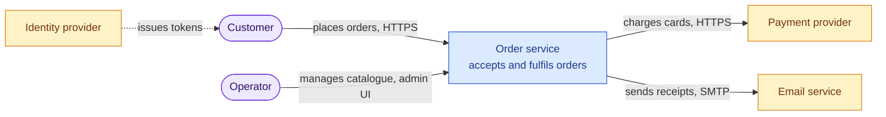
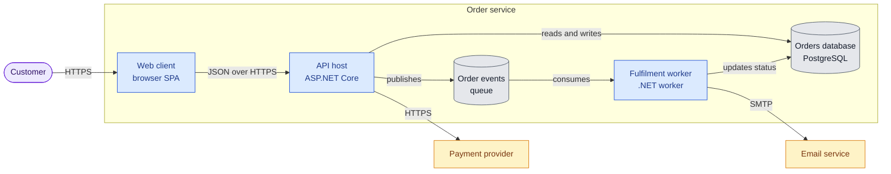
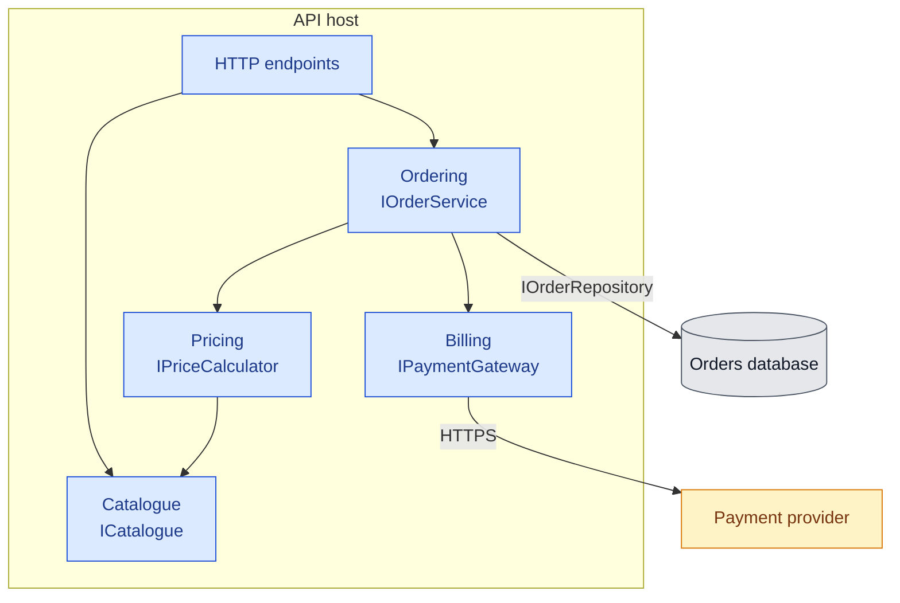
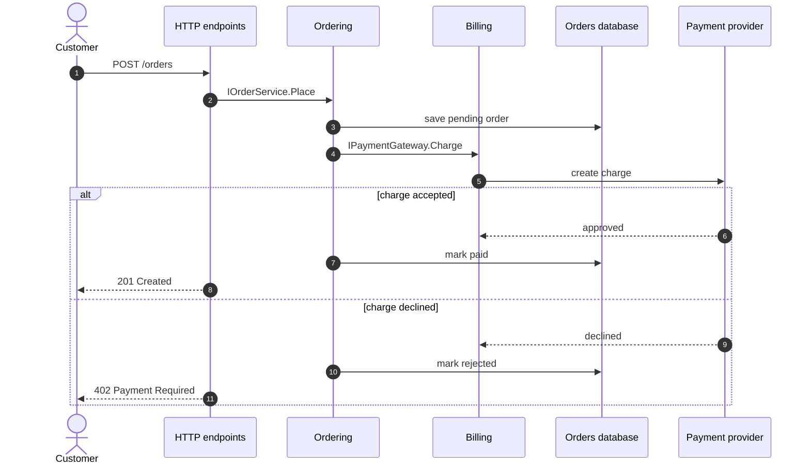
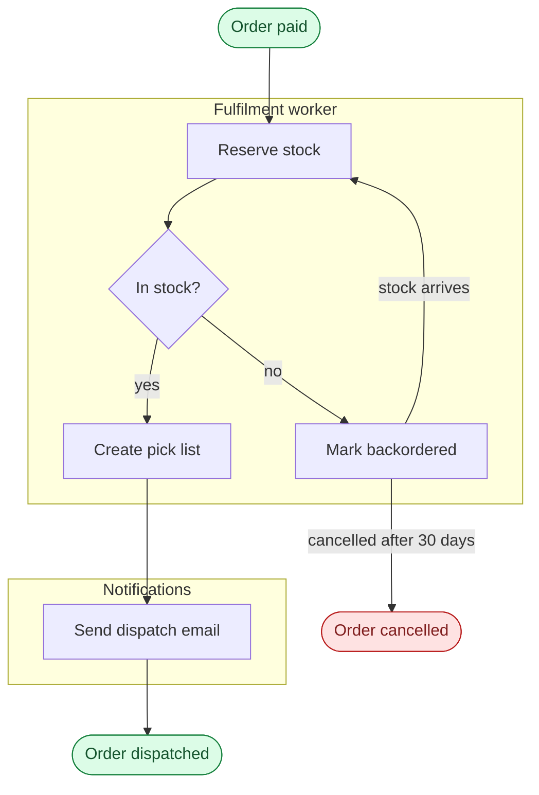
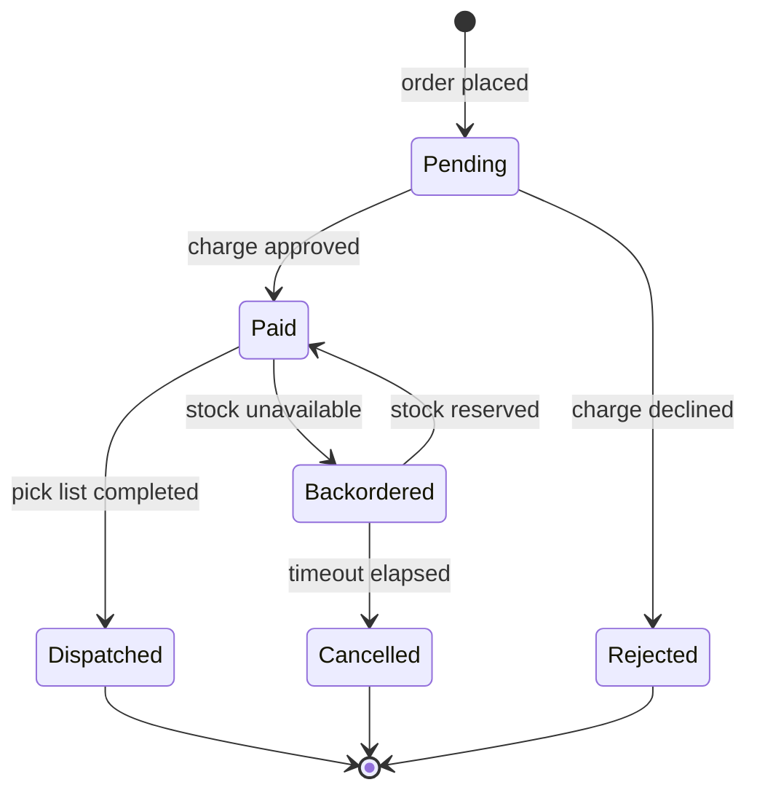
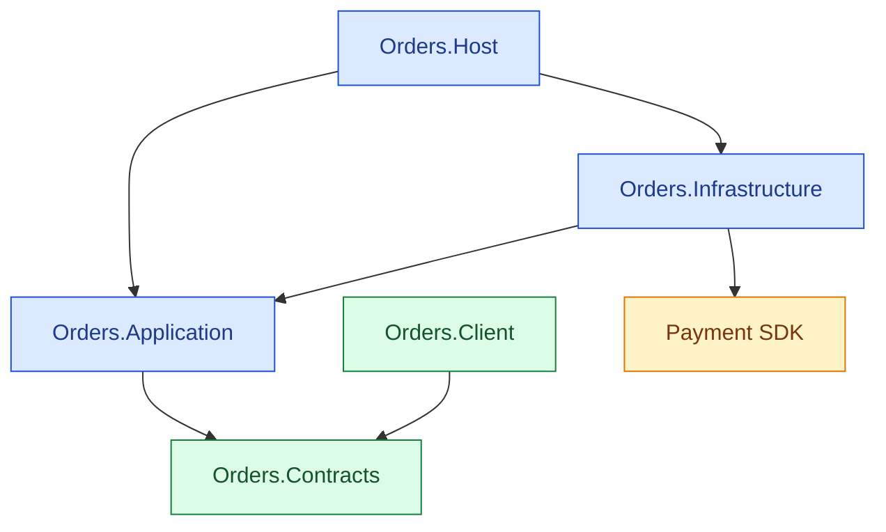

# View Catalogue

Rules and templates for each view in the [architecture diagrams skill](../SKILL.md). Templates use
synthetic names; replace every element with one verified in source. Styling classes and shapes come
from the [Mermaid conventions](./mermaid-conventions.md).

## Contents

- [System Context](#system-context)
- [Containers](#containers)
- [Components](#components)
- [Runtime Scenario](#runtime-scenario)
- [Activity Flow](#activity-flow)
- [Lifecycle](#lifecycle)
- [Dependency Graph](#dependency-graph)
- [Code Map](#code-map)
- [Native C4 Syntax](#native-c4-syntax)

## System Context

The system is one opaque box. Show every kind of person and external system that sends it input or
receives its output, and nothing inside it.

- One element for the system, styled `system`. Its label states what it is in a few words.
- People and calling applications as stadiums on the left; external dependencies on the right.
- Label every edge with what flows and how: `submits orders, HTTPS`, `publishes events, AMQP`.
  Direction follows the request or the data, whichever the reader cares about; be consistent.
- Group external systems only when several share an owner and a protocol.
- Omit infrastructure that is invisible to the system's behavior, such as a load balancer.

## Containers

Open the system box. A container is anything that runs as its own process or stores data on its own:
an API host, a worker, a scheduled job, a browser or mobile client, a database, a cache, a queue.

- Draw the system boundary as a subgraph labelled with the system name from the context view.
- Keep the people and external systems from the context view, with the same identifiers and styles,
  and re-attach each of their edges to the container that actually handles it.
- Label each container with its name and technology: `API host ASP.NET Core`.
- Data stores the system owns sit inside the boundary as cylinders, labelled with what they hold.
- A configuration-selected role of one image becomes its own container only when it is deployed
  separately; otherwise mention the roles in the container label.
- Libraries and NuGet or npm packages are not containers; they belong in the dependency graph.

## Components

Open one container. A component is a cohesive responsibility behind a small public surface: a group
of types that change together and are used through a few interfaces. It is not a class, a folder or a
technical layer, although a well-structured codebase makes each component one folder or project.

- One view per container; title the subgraph with the container name from the containers view.
- Five to twelve components. Name each by responsibility (`Pricing`, `Fulfilment`), not by layer
  (`Services`, `Helpers`, `Managers`).
- Put the provided interfaces in the label: `Pricing IPriceCalculator`. Name a port only when it
  is used across a component boundary.
- Label edges with the required port when the target provides more than one.
- Inbound adapters (controllers, consumers, MCP tools) form one component per protocol at the top.
  Outbound adapters may be shown as their own components when several components share them.
- Show the elements outside the container that components touch, with their established styles.
- A component the container registers from a package but does not implement, such as a shared
  pipeline library, stays in the view when it carries runtime behavior. Style it `published`, add a
  legend line, and name the package in the code map's location column.
- Draw only dependencies that exist in code. Missing expected edges and surprising extra ones are
  both findings for the report.

## Runtime Scenario

One use case end to end, in time order. Use it when the order of collaboration, an asynchronous
hand-off or a failure path is the point.

- Participants are containers or components from the static views, with the same names. Declare them
  in left-to-right order of first involvement, actors first.
- Label messages with the port operation or protocol message (`IOrderService.Place`, `POST /orders`),
  not private method chains.
- Use `autonumber`. Use `alt` and `else` for the significant failure, `opt` for conditional steps,
  `par` for concurrency and `loop` for retries or batches. Prefer one important failure path to
  exhaustive error handling.
- Show asynchronous messages with `-)` and replies with `-->>`.
- Aim for fifteen messages or fewer. Split a longer scenario at a natural hand-off.

## Activity Flow

A process with steps, decisions and hand-offs between owners: an ingestion pipeline, an approval
workflow, a build and release flow. Use it when branching matters more than timing.

- Start and end nodes are stadiums. Decisions are diamonds whose outgoing edges are labelled with the
  outcome. Steps are verb phrases.
- Use subgraphs as swimlanes for the component, container or role that owns each step.
- Show loops back explicitly with a labelled edge rather than duplicating steps.
- Mermaid has no fork and join bar. Show parallel branches as edges from one step that rejoin at a
  step labelled with the join condition.

## Lifecycle

The states one entity, job or session can occupy, and the events that move it. Use it when a status
column or enum drives behavior across several components.

- Derive states from the enum or status values in code; derive transitions from the code that sets
  them. Never invent intermediate states.
- Label transitions with the triggering event or operation.
- Mark terminal states with transitions to `[*]`.

## Dependency Graph

Which build units reference which. Generate it from manifests: project files, package manifests,
module files or chart dependencies. Never draw it from memory.

- Edges point from the dependent to its dependency, labelled only when the kind of reference differs
  (`project`, `package`, `build-only`).
- Group by layer or deployable with subgraphs; style owned units differently from external packages.
- Exclude test projects unless the graph exists to explain test topology.
- Include external packages only when they define an important boundary, such as a provider SDK.
- A cycle, or an edge pointing from a core unit to an adapter or user interface, is a finding.

## Code Map

The bridge from diagrams to source. It is a table, not a diagram, and lives under `## Code Map` in the
drilldown next to the components view it describes.

| Component | Responsibility | Code location | Provides | Requires |
| --- | --- | --- | --- | --- |
| Ordering | Accepts, validates and tracks orders | `src/Orders.Application/Ordering/` | `IOrderService` | `IPriceCalculator`, `IPaymentGateway`, `IOrderRepository` |
| Pricing | Calculates order totals and discounts | `src/Orders.Application/Pricing/` | `IPriceCalculator` | `ICatalogue` |

- One row per component in the components view, in the same order.
- Code location uses folders, namespaces or file-name patterns that a reader can glob. When a
  component is scattered, list every location; the scatter is itself a finding.
- Provides and Requires list ports, endpoints or protocols, never concrete classes.

## Native C4 Syntax

Mermaid's `C4Context`, `C4Container` and `C4Component` diagrams, and the `architecture-beta`
diagram, are experimental. Their layout is hard to control, styling differs between renderers and
syntax may change. Use `flowchart` with the conventions above unless the repository already uses
native C4 diagrams and every renderer its readers use has been verified.
