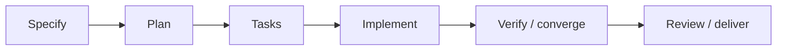

# Spec Kit Session Tutor

Orient the user in the current Spec Kit workflow, explain the next useful action and offer safe
shortcuts. Keep the answer short and specific to the selected feature, not a generic command tour.
Invoke `/spec-kit-guide`, optionally naming a feature or asking which stages can be skipped.

## Establish Where You Are

1. Identify the active repository and any feature explicitly named in this conversation or request.
   Compare it with the effective `SPECIFY_FEATURE_DIRECTORY` environment override and the project's
   `.specify/feature.json`, when present. Read the installed routing rules if needed; versions differ.
   A shared persisted selection may have changed in another session. If evidence conflicts or multiple
   features are plausible, show the candidates and ask one focused question. Never silently switch
   features, use the newest folder, or assume the Git branch identifies the feature.
2. Find the last actual Spec Kit invocation and its outcome visible in this conversation, including
   failures, partial runs and interruptions. A suggested command is not an invocation. If history is
   missing after a context switch, say "Last command: not observable in this session." Do not invent
   history from timestamps, Git commits or artifact existence. Do not search other sessions unless asked.
3. Read only the selected feature's nearby evidence: `spec.md`, `plan.md`, `tasks.md`, relevant
   checklists and recorded verification or handover notes. Inspect the constitution when it affects
   readiness. Summarize missing/stale artifacts, unchecked tasks and actual blockers. A file's presence
   does not prove a command succeeded; checked tasks do not prove acceptance or tests passed.
4. Distinguish the last observed command from the current inferred stage. Other sessions can update
   shared files; this is a snapshot, not an exclusive session ledger. Surface conflicting or stale
   evidence rather than reconciling it by editing files.

## Choose The Next Action

Use the installed command skills as the authority for prerequisites and invocation syntax. The table
uses the central Copilot hyphenated names; adapt only when the current integration demonstrates a
different spelling. Read the relevant command definition before advising on version-specific behavior.
If a command is unavailable, say so rather than implying it is installed or silently installing it.

| Current evidence | Recommended next action | Alternative and tradeoff |
| --- | --- | --- |
| Spec Kit is not initialized | Use the Spec Kit bootstrap skill. | Explain the workflow first; setup needs a separate request. |
| Governance is missing or needs a deliberate change | `/speckit-constitution` | Reuse adequate existing governance; do not rewrite it for every feature. |
| No usable feature specification | `/speckit-specify` | Resume an existing explicitly selected feature instead of creating a duplicate. |
| Specification has consequential ambiguities | `/speckit-clarify` | Go to `/speckit-plan` only when those decisions are already resolved; skipping clarification leaves assumptions unchecked. |
| Specification is ready, no current plan | `/speckit-plan` | Skip a clarification pass when there are no unresolved material questions, not the planning prerequisites. |
| Plan is ready, task breakdown missing | `/speckit-tasks` | `/speckit-checklist` can audit requirements quality first; it does not create implementation tasks or prove runtime behavior. |
| Tasks exist, implementation not started | `/speckit-analyze`, then `/speckit-implement` after addressing blockers | Go directly to implementation if the consistency review is unnecessary and prerequisites hold; state the missed review. |
| Implementation or verification tasks remain | Resume `/speckit-implement` for actionable work. | Address an external/manual acceptance blocker first; repeating implementation cannot manufacture its evidence. |
| Implementation appears complete | `/speckit-converge` to compare the code against spec, plan and tasks. | Use `/speckit-analyze` for document consistency, not as proof that the implementation meets the specification. |
| Convergence added missing work | `/speckit-implement`, then reassess convergence. | Resolve changed requirements through the affected spec/plan/tasks before implementing obsolete work. |
| No remaining gaps and acceptance is evidenced | Follow the repository's review and delivery workflow. | There may be no next Spec Kit command; commit, PR and release are separate authorized actions. |

Offer at most two relevant alternatives, with the prerequisite and lost assurance for each skip.
`/speckit-checklist` is a requirements-quality aid, not a mandatory linear stage or runtime test suite.
Skip only optional reviews whose omission the workflow allows; never skip required artifacts,
unresolved blockers, constitution requirements, acceptance evidence or approval gates. Prefer a
concrete manual action over a command when that is what actually unblocks the feature.

## Progress Flow

Include one small fenced `mermaid` diagram using `flowchart LR`, rectangular boxes and connecting
arrows. Keep five to seven short stage labels, adapting this outline to the installed workflow:

Mark the evidence-supported current box with `NOW:`, the recommended next box with `NEXT:` when
different, and include a short blocker in the current label when useful. Mark completion only when
supported, not because an artifact exists. If the current stage is unknown, say so instead of placing
a misleading marker. Optional clarification/checklist/analysis stages may be omitted or shown as
dashed side paths; arrows are orientation, not permission to skip prerequisites or approval gates.

Always include a plain-text current/next summary below the diagram as a fallback for clients that
do not render Mermaid. Rendering depends on the chat client; do not claim editor support was tested.
Use only a fenced diagram, with no HTML, clickable actions or external rendering/upload service.

## Response Shape And Boundaries

Return the selected repository/feature, the last observed command with outcome (or unknown), the
current stage with one or two evidence links, one recommended next action with its purpose, and up to
two useful alternatives. Mention the first blocker or approval needed. For example, an installed
extension with editor invocation unverified needs that editor check before final acceptance, not
another implementation pass. Do not report the feature complete merely because most tasks are checked.

Explain only. Do not invoke suggested commands or their hooks, run setup scripts that persist state,
edit tracking files, execute tests, install tools, commit or push. A request to tutor or list shortcuts
does not authorize those actions. Leave execution to a separate explicit request and the owning
command's instructions. Do not create a second progress ledger or require a new tracking document.

## Maintaining This Skill

- Recheck command availability, invocation names and prerequisites when the installed Spec Kit or Copilot integration changes.
- Recheck feature-routing precedence and read-only inspection when Spec Kit changes its selection files or environment overrides.
- Keep command outcomes distinct from artifact inference, especially after context compaction or concurrent-session edits.
- Recheck Mermaid rendering conventions when the chat client changes; retain explicit text markers and the plain-text fallback.
