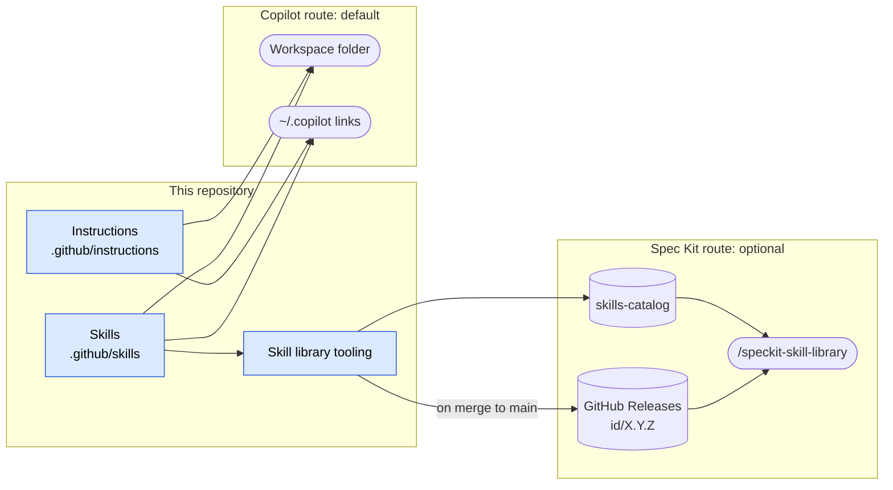

# .github

A central library of GitHub Copilot instructions and agent skills for agentic development across
many repositories. Copilot reads them directly from this repository; Spec Kit users can optionally
install selected skills as versioned extensions.

## What It Provides

- **[Instructions](.github/instructions/)**: language, tool and documentation conventions that
  Copilot applies automatically to matching files, such as C#, Terraform, Dockerfiles and Markdown.
- **[Skills](docs/skills.md)**: task-specific workflows with scripts, examples and safety gates,
  loaded when a request matches or invoked directly, such as `/docs-readme`.

Consumer repositories do not copy these files. Each keeps only its own
`.github/copilot-instructions.md` with a pointer here and its project-specific rules, so a change
in this repository takes effect everywhere without a pull request in each consumer.

## Service Architecture



The Copilot route reads the working tree directly, so it always reflects the checked-out branch.
The Spec Kit route installs published, immutable versions. [How the repository works](docs/architecture.md)
details versioning, packaging and installation with further diagrams.

## Use with Copilot

### Add to a Workspace

1. Clone this repository alongside the repository you are working on.
2. In VS Code, use **File > Add Folder to Workspace** to add this repository, then save the workspace.
3. Select the **Copilot** agent harness and run **Chat: Open Customizations** from the Command Palette.
   Confirm that the shared instructions and skills are available to that session.
4. Ask for a relevant task, or invoke a skill directly, such as `/docs-readme`.

Discovery depends on the selected agent harness; use the
[VS Code customization documentation](https://code.visualstudio.com/docs/agent-customization/overview)
and the active session's customization view to verify what is loaded.

### Install for Every Workspace

To use the shared files in every workspace without adding this repository to each one, link its
folders into your personal Copilot locations. Choose one route, workspace or personal, to avoid
loading the same files twice.

The examples assume a clone under `source/github/.github` in your home directory. Adjust that
location first, and run them only when the destination links do not already exist. Preserve any
existing personal customizations rather than overwriting them.

Windows PowerShell:

```powershell
$repo = "$HOME\source\github\.github"
New-Item -ItemType Directory -Force -Path "$HOME\.copilot" | Out-Null
foreach ($name in 'instructions', 'skills') {
  New-Item -ItemType Junction -Path "$HOME\.copilot\$name" -Target "$repo\.github\$name"
}
```

macOS and Linux:

```bash
repo="$HOME/source/github/.github"
mkdir -p "$HOME/.copilot"
for name in instructions skills; do
  ln -s "$repo/.github/$name" "$HOME/.copilot/$name"
done
```

The links point at the working tree, so a `git pull` updates every workspace at once. Recreate them
on another workstation; harness-folder customizations do not roam through VS Code Settings Sync.

## Use with Spec Kit

Spec Kit repositories can install selected skills at exact versions, with the skills they require,
through the `/speckit-skill-library` command. Each skill is released independently as a Spec Kit
extension. See [Versioned Skills for Spec Kit](docs/spec-kit.md).

## FAQ

### Do I need Spec Kit?

No. Copilot reads the instructions and skills directly once this repository is in your workspace or
linked into `~/.copilot`. Spec Kit is only for repositories that want selected skills pinned to
exact versions.

### How does Copilot decide what to load?

Each instruction file's `applyTo` glob matches the files being edited. Each skill's `description`
is matched against the request, or you invoke the skill by name, such as `/docs-adr`.

### Why not copy the files into each repository?

Copies drift and every update needs a pull request per repository. Here, one change reaches every
workspace on the next `git pull`. Repositories keep only their own specific rules.

### How are skills versioned?

Each skill has its own semantic version in `skill.metadata.yaml`, released as the tag
`<skill>/X.Y.Z`. A pull request fails if a changed skill was not bumped, or was bumped more than one
step past its last release. See [Versioning](docs/architecture.md#versioning).

### What does "required" versus "related" mean?

A required skill is always installed with the skill that needs it, at a pinned version. A related
skill is only offered, with a reason, and you choose whether to install it.

### What is inside a skill's Spec Kit extension?

An `extension.yml` manifest, the skill folder, the instruction files it links to and the licence,
all under their original repository paths. See [Packaging](docs/architecture.md#packaging).

### When are new versions published?

When a pull request merges to `main`, CI publishes a GitHub Release for every skill version that has
no tag yet and refreshes the catalog. Published releases never change.

### Can I keep private or local-only skills?

Yes. A Git-ignored skill folder is still loaded by Copilot from your clone but is never validated,
packaged or published. The [local overrides skill](.github/skills/tooling-local-overrides/SKILL.md)
covers the options.

## Further Documentation

| Document | Contents |
| --- | --- |
| [How the repository works](docs/architecture.md) | Structure, versioning, packaging and installation, with diagrams |
| [Skill catalogue](docs/skills.md) | Every skill, grouped by area |
| [Versioned skills for Spec Kit](docs/spec-kit.md) | Optional versioned installation |
| [Repository management](docs/repository-management.md) | Baseline audits, repository creation and GitHub community defaults |
| [Development](docs/development.md) | Tests and validation for changes to this repository |
| [EditorConfig generation](docs/editorconfig.md) | Shared formatting and analyzer fragments and their generator |
| [ADR 0001](docs/adr-0001-skill-library-distribution.md) | Skill library distribution design and status |

This public account-level repository also supplies GitHub's default issue forms, pull request
template, [contribution guidance](CONTRIBUTING.md) and [support guidance](SUPPORT.md) to
repositories that do not define their own.

## License

This repository is available under the [MIT License](LICENSE).
