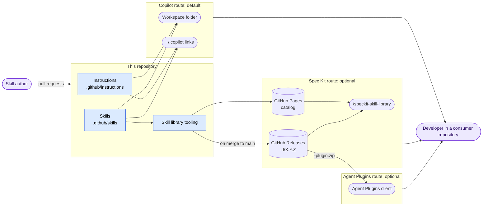

# .github

A central library of [GitHub Copilot](https://github.com/features/copilot) instructions and agent
skills for agentic development across many repositories. Copilot reads them directly from this
repository; the skills are also published as versioned [Spec Kit](https://github.com/github/spec-kit)
extensions and as [Agent Plugins](https://agent-plugins.org/).

## Three Ways to Use the Skills

| Route | Best for | What you get | Updates |
| --- | --- | --- | --- |
| [1. Copilot](#use-with-copilot) | Day-to-day work in VS Code | Every instruction, applied automatically by `applyTo`, and every skill, from the checked-out branch | `git pull` |
| [2. Spec Kit extensions](#use-with-spec-kit) | Spec Kit repositories that pin versions | Chosen skills at exact versions, with their required skills and linked instructions, copied into `.github/` and applied automatically | `/speckit-skill-library upgrade-all` |
| [3. Agent Plugins](#use-as-agent-plugins) | Any client that supports [Agent Plugins](https://agent-plugins.org/) | One skill per package at an exact version, with its linked instructions as reference files | Download the newer package |

Routes 1 and 2 apply instructions automatically: route 2 copies each installed skill's instructions
into `.github/instructions/`. Route 3 carries the instruction files a skill links to, which the
agent reads when it follows the link. Pick one route per workspace to avoid loading the same skill
twice.

## What It Provides

- **[Instructions](.github/instructions/)**: language, tool and documentation conventions that
  Copilot applies automatically to matching files, such as C#, Terraform, Dockerfiles and Markdown.
- **[Skills](docs/skills.md)**: task-specific workflows with scripts, examples and safety gates,
  loaded when a request matches or invoked directly, such as `/docs-readme`.

Consumer repositories do not copy these files. Each keeps only its own
`.github/copilot-instructions.md` with a pointer here and its project-specific rules, so a change
in this repository takes effect everywhere without a pull request in each consumer.

## System Context

Skill authors change this repository through pull requests; developers in consumer repositories
receive its instructions and skills through one of three routes.



The Copilot route reads the working tree directly, so it always reflects the checked-out branch.
The Spec Kit and Agent Plugins routes install published, immutable versions from the same release.
[How the repository works](docs/architecture.md) details versioning, packaging and installation
with further diagrams, and [Skill Library Tooling](docs/architecture/skill-library-tooling.md) shows
the PowerShell components behind them.

## Use with Copilot

### Add to a Workspace

1. Clone this repository alongside the repository you are working on.
2. In VS Code, use **File > Add Folder to Workspace** to add this repository, then save the workspace.
3. Select the **Copilot** agent harness and run **Chat: Open Customizations** from the Command Palette.
   Confirm that the shared instructions and skills are available to that session.
4. Ask for a relevant task, or invoke a skill directly, such as `/docs-readme`.

Discovery depends on the selected agent harness; use the
[VS Code customization documentation](https://code.visualstudio.com/docs/agent-customization/overview)
and the active session's customization view to verify what is loaded. A **Copilot CLI** (agent
host) session reads workspace customizations only from the folder it starts in, so it sees this
repository's files only when it runs inside this repository. For agent sessions anywhere else,
install the personal links below.

### Install for Every Workspace

To use the shared files in every workspace and every agent session, link its folders into your
personal Copilot locations. The links can coexist with this repository open in the workspace, which
remains the convenient way to edit it.

The examples assume a clone under `source/github/.github` in your home directory. Adjust that
location first, and run them only when the destination links do not already exist. Preserve any
existing personal customizations rather than overwriting them.

Windows PowerShell:

```powershell
$repo = "$HOME\source\github\.github"
New-Item -ItemType Directory -Force -Path "$HOME\.copilot" | Out-Null
foreach ($name in 'instructions', 'skills') {
  New-Item -ItemType Junction -Path "$HOME\.copilot\$name" -Target "$repo\.github\$name"
}
```

macOS and Linux:

```bash
repo="$HOME/source/github/.github"
mkdir -p "$HOME/.copilot"
for name in instructions skills; do
  ln -s "$repo/.github/$name" "$HOME/.copilot/$name"
done
```

The links point at the working tree, so a `git pull` updates every workspace at once. Recreate them
on another workstation; harness-folder customizations do not roam through VS Code Settings Sync.
Restart VS Code after creating or removing them: agent sessions discover `~/.copilot` only at
start-up.

VS Code releases before 1.144.0 loaded every file in `~/.copilot/instructions` twice in agent
sessions ([microsoft/vscode#342394](https://github.com/microsoft/vscode/issues/342394)). If a session
still lists each instruction twice, update VS Code rather than removing the links, which would leave
agent sessions in other repositories without the shared files.

### Remove the Personal Links

To uninstall, remove the links. Only links are removed; a real folder at either path is left
untouched, as is the clone.

Windows PowerShell:

```powershell
foreach ($name in 'instructions', 'skills') {
  $link = Get-Item -LiteralPath "$HOME\.copilot\$name" -Force -ErrorAction SilentlyContinue
  if ($link -and $link.LinkType) { $link.Delete() }
}
```

macOS and Linux:

```bash
for name in instructions skills; do
  if [ -L "$HOME/.copilot/$name" ]; then rm "$HOME/.copilot/$name"; fi
done
```

Run **Developer: Reload Window**, then confirm in **Chat: Open Customizations** that each shared
instruction and skill appears once.

### Alongside Third-Party Instruction Packs

Extensions that contribute instructions apply them by `applyTo` next to the shared set, so their
rules compete with these and add their own context cost. VS Code cannot switch off individual files
an extension contributes, so choose the narrowest pack instead. For
[HVE Core](https://github.com/microsoft/hve-core):

- Prefer `ise-hve-essentials.hve-core` over the `hve-core-all` bundle. The bundle includes
  `hve-coding-standards`, whose C#, PowerShell, Pester, Python, Rust, Bash and Terraform
  instructions overlap the shared language files; on a C# file they add about 16 KB.
- Even `hve-core` applies its Markdown and writing-style instructions to every `*.md` file (about
  21 KB) and a 36 KB prompt-builder instruction to `SKILL.md` and `*.instructions.md` files. When
  editing this repository, disable the extension for the workspace from the Extensions view.
- Its commit-message instruction, attached by the `git-commit` prompts and the RPI agents, requires
  an emoji and a `Generated by Copilot` footer. The shared workflow rule forbids both and takes
  precedence; before pushing, run the `repository-privacy` skill's `Remove-CommitAttribution.ps1`,
  which strips any attribution that slips through.

## Use with Spec Kit

Spec Kit repositories can install selected skills at exact versions, with the skills they require,
through the `/speckit-skill-library` command. Each skill is released independently as a Spec Kit
extension. See [Versioned Skills for Spec Kit](docs/spec-kit.md).

## Use as Agent Plugins

Every skill release also carries `<skill>-<version>-plugin.zip`, a package in the vendor-neutral
[Agent Plugins](https://agent-plugins.org/specification) format. Download it from the
[catalog](https://f2calv.github.io/.github/) or the skill's GitHub Release, extract it, and load the
folder with your client's plugin installation method. Agent Plugins has no dependencies, so install
each plugin listed under `required` in its `plugin.json` too. See
[Agent Plugins packaging](docs/architecture.md#agent-plugins).

## FAQ

### Do I need Spec Kit?

No. Copilot reads the instructions and skills directly once this repository is in your workspace or
linked into `~/.copilot`. Spec Kit is only for repositories that want selected skills pinned to
exact versions; other agent clients can use the Agent Plugins packages instead.

### How does Copilot decide what to load?

Each instruction file's `applyTo` glob matches the files being edited. Each skill's `description`
is matched against the request, or you invoke the skill by name, such as `/docs-adr`.

### Why not copy the files into each repository?

Copies drift and every update needs a pull request per repository. Here, one change reaches every
workspace on the next `git pull`. Repositories keep only their own specific rules.

### How are skills versioned?

Each skill has its own semantic version in `skill.metadata.yaml`, released as the tag
`<skill>/X.Y.Z`. A pull request fails if a changed skill was not bumped, or was bumped more than one
step past its last release. See [Versioning](docs/architecture.md#versioning).

### What does "required" versus "related" mean?

A required skill is always installed with the skill that needs it, at a pinned version. A related
skill is only offered, with a reason, and you choose whether to install it.

### What is inside a skill's Spec Kit extension?

An `extension.yml` manifest, the skill folder, the instruction files it links to and the licence,
all under their original repository paths. See [Packaging](docs/architecture.md#packaging).

### Why is each skill packaged as a Spec Kit extension?

To reuse a package manager instead of writing one. The extension format gives every skill a
catalog entry per published version, `specify extension add --version` downloads, SHA-256 digest
checks, a registry of installed versions, and enable, disable and remove commands. It also lets the
skills appear in any Spec Kit catalog alongside other Spec Kit packages. The first implementation
rebuilt installation itself, grew to about 10,000 lines and never shipped; see
[ADR 0001](docs/adr-0001-skill-library-distribution.md).

### Why does installing skills need an extension of its own?

The `skill` bootstrap extension fills the two gaps Spec Kit 1.2.3 leaves for skills:

- **Dependencies between packages.** Spec Kit checks only the required Spec Kit version. The
  bootstrap resolves required skills at their pinned versions, offers related skills, upgrades in
  dependency order and prunes skills nothing requires any more.
- **A skill package type.** Extensions can provide commands, hooks, scripts, templates and
  configuration, but not skills, and the Copilot integration registers only commands. The bootstrap
  copies each installed skill and its instructions into `.github/`, where Copilot discovers them.

If Spec Kit gains either feature, the bootstrap shrinks accordingly.

### Why are installed skills copied into `.github/`?

Spec Kit unpacks a skill under `.specify/extensions/<skill>/`, which Copilot never scans, so the
skill would load only through an explicit `/speckit-skill-library load` in the current chat. Copies
in `.github/skills/` and `.github/instructions/` are discovered in every new chat and applied by
`applyTo`, exactly like route 1. Copies rather than links give an audit trail: the bootstrap records
each copy's SHA-256, skill, version and copy date, and works on any operating system.

### What happens if I edit or remove an installed skill?

Before replacing a copy on upgrade or deleting it on `remove` or `prune`, the bootstrap compares the
file with the SHA-256 recorded when it was copied. Unchanged copies are replaced or deleted. A
modified copy, or a file the bootstrap never wrote, is kept and reported with the skill, version
and date it came from, so removing a skill never silently discards local changes. The record proves
that a file changed, not who changed it.

### What alternatives to extensions were considered?

| Alternative | Why not the Spec Kit route |
| --- | --- |
| Plain ZIPs downloaded and verified by the bootstrap | Rebuilds download, digest checks and the installed-version registry that Spec Kit already provides. |
| [Agent Plugins](#use-as-agent-plugins) only | Native skill format, but not a Spec Kit package; published from the same release as route 3. |
| Cloning or linking this repository | Route 1: no per-skill version selection. |
| A `skills` package type in Spec Kit | The cleanest fix for discovery, but it needs an upstream change. |

### Can I use the skills outside Copilot and Spec Kit?

Yes, in any client that supports [Agent Plugins](https://agent-plugins.org/). See
[Use as Agent Plugins](#use-as-agent-plugins). Linked instructions travel inside each package as
reference files; only the Copilot route applies them automatically.

### When are new versions published?

When a pull request merges to `main`, CI publishes a GitHub Release for every skill version that has
no tag yet and redeploys the [catalog on GitHub Pages](https://f2calv.github.io/.github/). Published
releases never change.

### How do I upgrade installed skills?

Run `/speckit-skill-library upgrade-all`. It moves every installed skill to its latest version,
required skills first, and stops without changes if a pin cannot be met. It installs newly required
skills, offers newly related ones, and reports skills no longer required, which
`/speckit-skill-library prune` removes. `/speckit-skill-library remove <skill>` removes a skill that
no other installed skill requires.

### Can I keep private or local-only skills?

Yes. A Git-ignored skill folder is still loaded by Copilot from your clone but is never validated,
packaged or published. The [local overrides skill](.github/skills/tooling-local-overrides/SKILL.md)
covers the options.

## Further Documentation

| Document | Contents |
| --- | --- |
| [How the repository works](docs/architecture.md) | Structure, versioning, packaging and installation, with diagrams |
| [Skill catalogue](docs/skills.md) | Every skill, grouped by area |
| [Skill metadata sidecar](docs/skill-metadata.md) | Every field of `skill.metadata.yaml`, including facets, dependencies and external files |
| [Versioned skills for Spec Kit](docs/spec-kit.md) | Optional versioned installation and upgrades |
| [End-to-end demos](docs/demo.md) | Scripted walkthroughs from Copilot use to publishing and upgrading skills |
| [Repository management](docs/repository-management.md) | Baseline audits, repository creation and GitHub community defaults |
| [Development](docs/development.md) | Tests and validation for changes to this repository |
| [EditorConfig generation](docs/editorconfig.md) | Shared formatting and analyzer fragments and their generator |
| [ADR 0001](docs/adr-0001-skill-library-distribution.md) | Skill library distribution design and status |
| [ADR 0002](docs/adr-0002-agent-plugins-packaging.md) | Agent Plugins packaging design and status |

This public account-level repository also supplies GitHub's default issue forms, pull request
template, [contribution guidance](CONTRIBUTING.md) and [support guidance](SUPPORT.md) to
repositories that do not define their own.

## License

This repository is available under the [MIT License](LICENSE).
