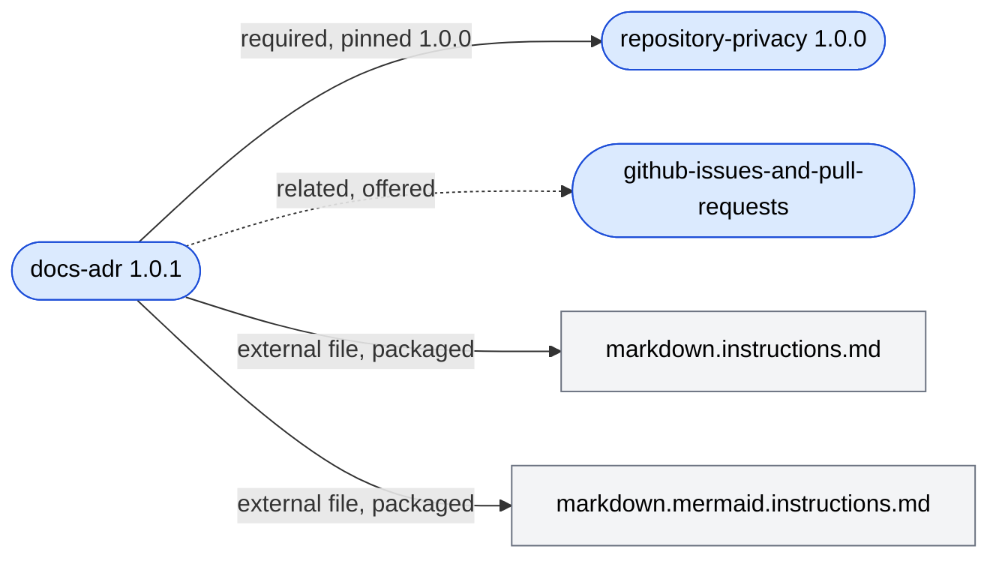
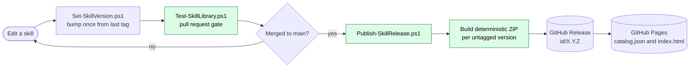
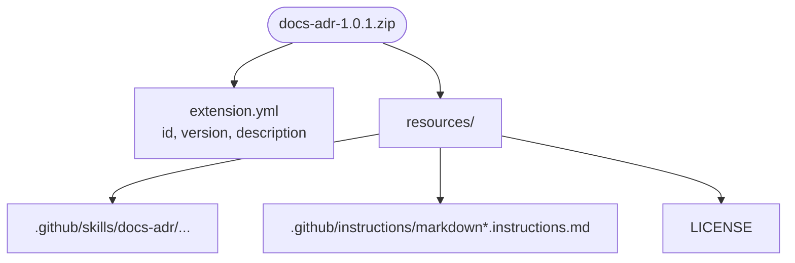
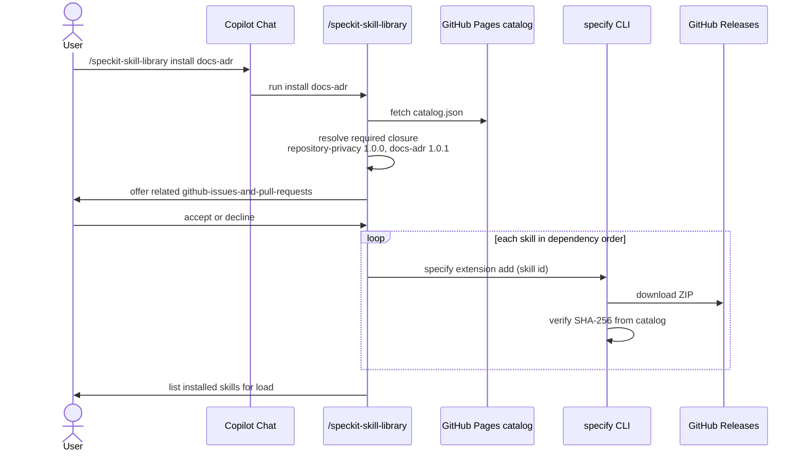

# How the Repository Works

This repository is the single source of truth for shared Copilot instructions and skills. It serves
them in two ways: directly from the working tree to Copilot, and as independently versioned Spec Kit
extensions published to GitHub Releases. This document explains the structure, the versioning rules
and the packaging pipeline behind both.

## Repository Layout

| Path | Contents |
| --- | --- |
| `.github/instructions/` | `*.instructions.md` files; each `applyTo` glob decides which files it governs |
| `.github/skills/<id>/` | One skill per folder: `SKILL.md`, optional scripts, references and examples, plus `skill.metadata.yaml` |
| `.github/skills/skill-library/` | The tooling that validates, versions, builds and publishes every skill |
| `src/skill-library-extension/` | The `skill` bootstrap extension that provides `/speckit-skill-library` |
| `.github/copilot-instructions.md` | Rules for authoring this repository itself, not part of the shared set |
| `docs/` | This documentation and the [distribution ADR](adr-0001-skill-library-distribution.md) |

## Dependency Graph

A skill's `skill.metadata.yaml` sidecar declares what it needs. **Required** skills are pinned to an
exact version and always installed with it. **Related** skills are offered with a reason and
installed only when chosen. **External files**, typically instructions the skill links to, are
packaged inside the skill's extension.

Required edges must not form a cycle; the validation check rejects one.

## Versioning

Every skill has its own semantic version in its sidecar. A release is the Git tag `<id>/X.Y.Z`.

| Change | Bump |
| --- | --- |
| Breaking guidance change | `major` |
| New capability | `minor` |
| Fix or clarification | `patch` (default) |
| A required skill was bumped | `patch` for each released dependent, with its pin updated |

Rules enforced on every pull request by `Test-SkillLibrary.ps1`:

- A skill, or any of its external files, that changed since its last tag must be bumped.
- A version may be at most one step past its last tag: `1.0.0` may become `1.0.1`, `1.1.0` or
  `2.0.0`, never `1.0.3`. However often a skill changes on a branch, it is bumped once.
- Every required pin must equal the required skill's current version.
- A skill that has never been released keeps its authored version; its first release uses it.

`Set-SkillVersion.ps1` applies these rules. It always bumps from the last released tag, so running it
repeatedly during a long session never stacks bumps, and it cascades pin updates and patch bumps to
dependents.

## Deployment Flow

On `main`, CI publishes each component whose version has no tag yet. Publishing the release creates
the tag on the merge commit. CI then regenerates `catalog.json`, listing every published version with
its download URL and SHA-256 digest, plus a browsable `index.html`, and deploys both to
[GitHub Pages](https://f2calv.github.io/.github/). The ZIPs stay on the releases. Published
releases are never changed or moved.

## Packaging

Each skill becomes one Spec Kit extension ZIP. Required skills are separate extensions, not bundled.

Files keep their repository paths under `resources/`, so relative links between a skill and its
instructions still resolve after installation. Only committed files are packaged, and rebuilding the
same commit produces byte-identical archives.

## Installation Flow

`/speckit-skill-library upgrade-all` follows the same path for every installed skill whose catalog
version is newer, replacing it with `specify extension add --force`.

## Native and Versioned Routes Compared

| Aspect | Native Copilot route | Spec Kit route |
| --- | --- | --- |
| Setup | Add to workspace or link into `~/.copilot` | `specify extension add skill`, then `/speckit-skill-library install` |
| Version | Whatever the clone has checked out | Exact published versions |
| Selection | Every instruction and skill | Chosen skills plus their required closure |
| Updates | `git pull` | `/speckit-skill-library upgrade-all` |
| Prerequisites | VS Code with Copilot | Specify CLI, PowerShell 7.4+, access to GitHub Pages and Releases |
