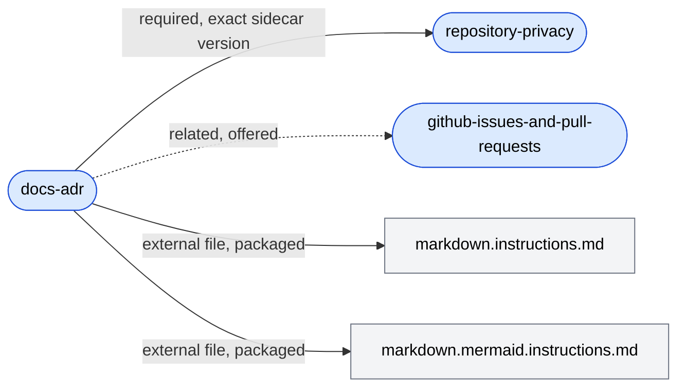
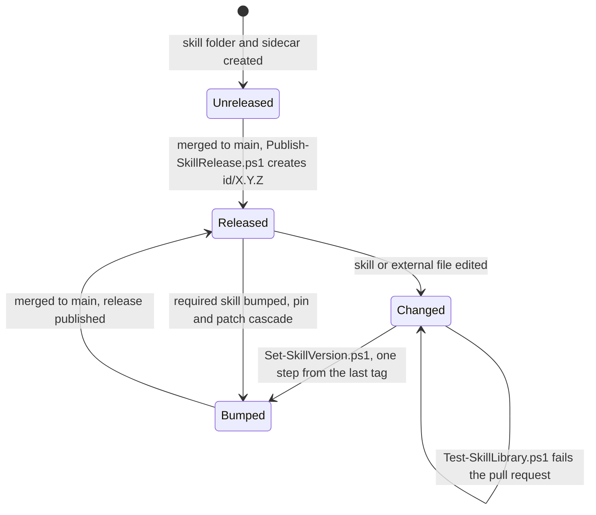
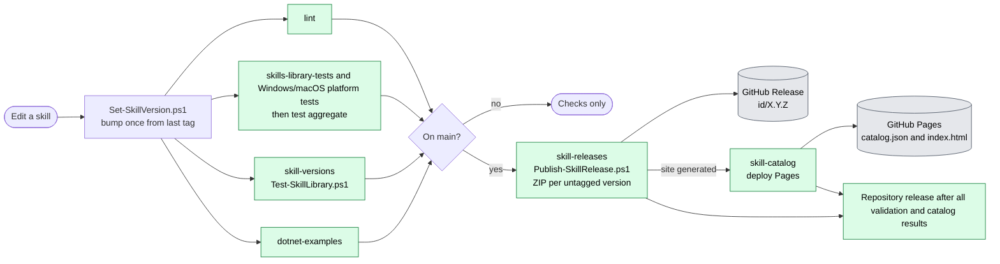
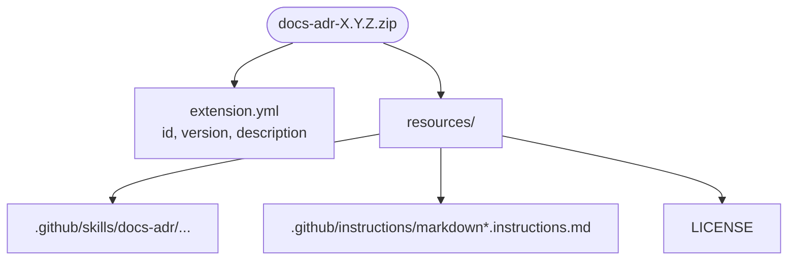
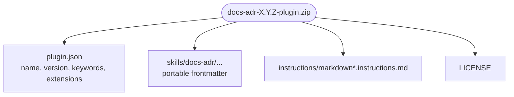
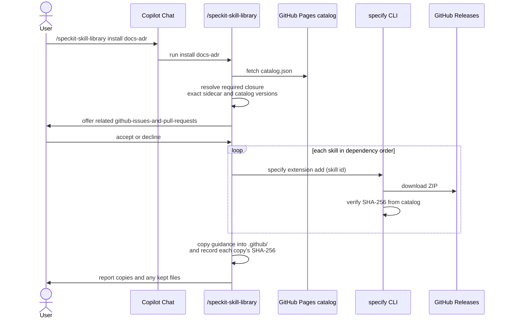
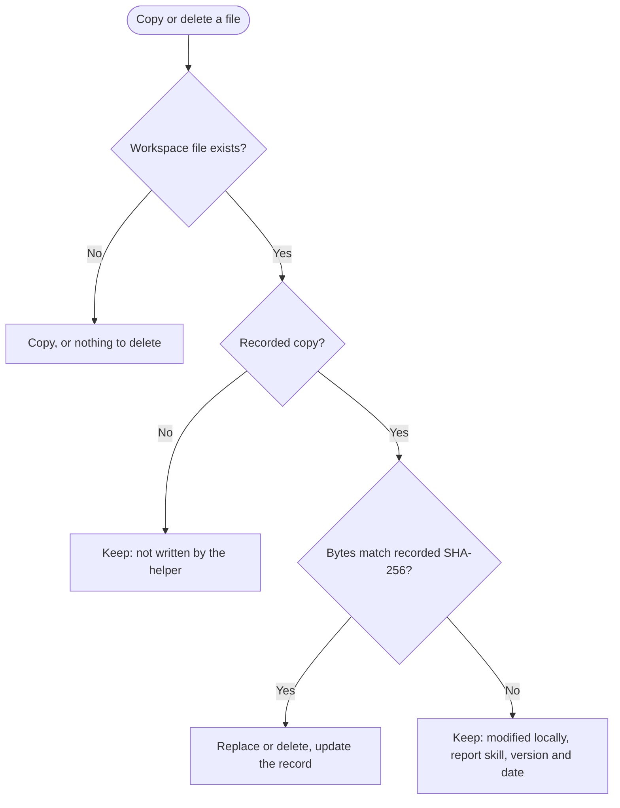

# How the Repository Works

This repository is the single source of truth for shared Copilot instructions and skills. It serves
them through Copilot workspace guidance, independently versioned Spec Kit extensions and Agent
Plugins. This document explains the structure, versioning, packaging and installation behind
the three supported routes.

## Repository Layout

| Path | Contents |
| --- | --- |
| `.github/instructions/` | `*.instructions.md` files; each `applyTo` glob decides which files it governs |
| `.github/skills/<id>/` | One skill per folder: `SKILL.md`, optional scripts, references and examples, plus `skill.metadata.yaml` |
| `.github/skills/skill-library/` | The tooling that validates, versions, builds and publishes every skill; see [Skill Library Tooling](architecture/skill-library-tooling.md) for its components |
| `src/skill-library-extension/` | The `skill` bootstrap extension that provides `/speckit-skill-library` |
| `.github/copilot-instructions.md` | Rules for authoring this repository itself, not part of the shared set |
| `docs/` | This documentation and the [distribution ADR](adr-0001-skill-library-distribution.md) |

## Dependency Graph

A skill's `skill.metadata.yaml` sidecar declares what it needs. **Required** skills are pinned to an
exact version and always installed with it. **Related** skills are offered with a reason and
installed only when chosen. **External files**, typically instructions the skill links to, are
packaged inside the skill's extension. **Facets** are search tags. The
[sidecar reference](skill-metadata.md) explains every field.

Required edges must not form a cycle; the validation check rejects one.

## Versioning

Every skill has its own semantic version in its sidecar. A release is the Git tag `<id>/X.Y.Z`.

| Change | Bump |
| --- | --- |
| Breaking guidance change | `major` |
| New capability | `minor` |
| Fix or clarification | `patch` (default) |
| A required skill was bumped | `patch` for each released dependent, with its pin updated |

Rules enforced on every pull request by `Test-SkillLibrary.ps1`:

- A skill, or any of its external files, that changed since its last tag must be bumped.
- A version may be at most one step past its last tag: `1.0.0` may become `1.0.1`, `1.1.0` or
  `2.0.0`, never `1.0.3`. However often a skill changes on a branch, it is bumped once.
- Every required pin must equal the required skill's current version.
- A skill that has never been released keeps its authored version; its first release uses it.

`Set-SkillVersion.ps1` applies these rules. It always bumps from the last released tag, so running it
repeatedly during a long session never stacks bumps, and it cascades pin updates and patch bumps to
dependents.

## Skill Version Lifecycle

A skill's version moves between these states as it is edited, bumped and published.

## Deployment Flow

Releases are published by jobs in the [CI workflow](../.github/workflows/ci.yml). Every pull request
and default-branch push runs the checks; only `main` publishes.

On `main`, CI publishes each component whose version has no tag yet. Publishing the release creates
the tag on the merge commit. CI then regenerates `catalog.json`, listing every published version with
its download URL and SHA-256 digest, plus a browsable `index.html`, and deploys both to
[GitHub Pages](https://f2calv.github.io/.github/). The ZIPs stay on the releases. Published
releases are never changed or moved.

## Packaging

Each skill becomes one Spec Kit extension ZIP. Required skills are separate extensions, not bundled.

Files keep their repository paths under `resources/`, so relative links between a skill and its
instructions still resolve after installation. Only committed files are packaged, and rebuilding the
same commit produces byte-identical archives.

### Agent Plugins

The same release also carries the skill as an [Agent Plugins](https://agent-plugins.org/) package,
built from the same commit and version. The decision is recorded in
[ADR 0002](adr-0002-agent-plugins-packaging.md).

- External files drop their `.github/` prefix, so the skill's `../../instructions/...` links resolve
  inside the plugin root, as the specification requires.
- VS Code-only frontmatter fields move into `metadata` in the package, so strict clients accept the
  skill. The source files are unchanged.
- Required and related skills are recorded under the `io.github.f2calv.skill-library` extension
  namespace. Agent Plugins has no dependency mechanism, so a client installs only the one skill.
- Instructions are inert reference files read when the skill follows a link; `applyTo` matching
  happens only in the Copilot and Spec Kit routes.
- The `speckit-*` skills that `specify init` generates belong to Spec Kit and are never validated,
  versioned or packaged here.

## Installation Flow

`/speckit-skill-library upgrade-all` follows the same path for every installed skill whose catalog
version is newer, replacing it with `specify extension add --force` and installing newly required
skills. It then offers newly related skills and reports skills no chosen skill requires, which
`/speckit-skill-library prune` removes with `specify extension remove`; `remove <skill>` removes one
chosen skill that nothing else requires. The helper records chosen versus required skills, and each
copied file's SHA-256, in `.specify/extensions/.skill-library.json`.

### Copied Guidance

Spec Kit extensions cannot provide skills, so Copilot never discovers a skill left under
`.specify/extensions/`. After each change the helper mirrors every enabled skill's
`resources/.github/` into the workspace `.github/` and reconciles the copies against their records:

When two skills ship the same instruction file, the copy from the first skill by ID is used and a
differing copy is reported.

## Routes Compared

| Aspect | Copilot route | Spec Kit route | Agent Plugins route |
| --- | --- | --- | --- |
| Setup | Add to workspace or link into `~/.copilot` | `specify extension add skill`, then `/speckit-skill-library install` | Download and extract `<skill>-<version>-plugin.zip`, then load it in the client |
| Version | Whatever the clone has checked out | Exact published versions | Exact published versions |
| Selection | Every instruction and skill | Chosen skills plus their required closure | One skill per plugin; required plugins installed by hand |
| Instructions | Applied automatically by `applyTo` | Copied into `.github/instructions/` and applied by `applyTo` | Linked files packaged as reference |
| Updates | `git pull` | `/speckit-skill-library upgrade-all` | Replace with the newer package |
| Prerequisites | VS Code with Copilot | Specify CLI, access to GitHub Pages and Releases, and PowerShell 7.4+, Bash 4+ with `jq`, or Python for the chosen helper variant | An Agent Plugins client and access to GitHub Releases |
