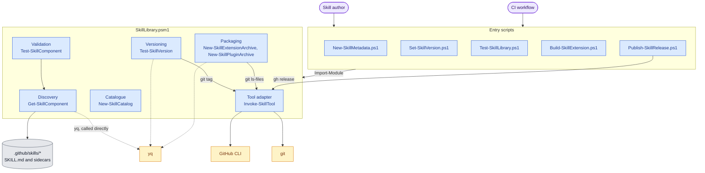

# Skill Library Tooling

How the PowerShell tooling behind the skill library is structured. The
[repository architecture](../architecture.md) explains what the tooling does: sidecars, versioning,
packaging, publication and installation. This page shows which parts of the code do it.

## Tooling Components

Five entry scripts share one module, `SkillLibrary.psm1`. Each script composes a different subset of
the module's responsibilities. `git` and `gh` run through the module's tool adapter, which turns a
non-zero exit into an error carrying the tool's output; `yq` is called directly where YAML is read,
edited or generated.

Which responsibilities each script composes:

| Script | Discovery | Validation | Versioning | Packaging | Catalogue |
| --- | --- | --- | --- | --- | --- |
| `New-SkillMetadata.ps1` | Yes | Links only | | | |
| `Set-SkillVersion.ps1` | Yes | | Yes | | |
| `Test-SkillLibrary.ps1` | Yes | Yes | Yes | | |
| `Build-SkillExtension.ps1` | Yes | Yes | | Yes | Yes |
| `Publish-SkillRelease.ps1` | Yes | Yes | Yes | Yes | Yes |

The consumer side is separate: the `skill` bootstrap extension's `Invoke-SkillLibrary.ps1` reads
`catalog.json` and drives `specify extension add`, as the
[installation flow](../architecture.md#installation-flow) shows.

## Code Map

All module functions live in
[SkillLibrary.psm1](../../.github/skills/skill-library/scripts/SkillLibrary.psm1); each entry script
sits beside it in [scripts/](../../.github/skills/skill-library/scripts/) with a matching test in
`scripts/tests/`.

| Component | Responsibility | Functions | Requires |
| --- | --- | --- | --- |
| Discovery | Finds skill folders, excludes Git-ignored ones, reads sidecars and frontmatter | `Get-SkillComponent`, `New-SkillComponent`, `Get-SkillIgnoredPath`, `Get-SkillWithoutMetadata`, `Get-SkillFrontmatter`, `Read-SkillYaml`, `ConvertFrom-SkillYaml` | yq |
| Validation | Checks sidecar schema, links, required-skill cycles and catalogue rows | `Test-SkillComponent`, `Get-SkillLink`, `Test-SkillCatalogue`, `Get-SkillCatalogueVersion` | Discovery |
| Versioning | Compares each skill with its last `<id>/X.Y.Z` tag and enforces one-step bumps | `Test-SkillVersion`, `Test-SkillChanged`, `Get-SkillReleasedVersion`, `Get-SkillVersionPath`, `ConvertTo-SkillVersion`, `Set-SkillMetadataValue`, `Set-SkillCatalogueVersion` | Tool adapter, yq |
| Packaging | Builds deterministic extension and Agent Plugins ZIPs from committed files | `New-SkillExtensionArchive`, `New-SkillPluginArchive`, `New-SkillExtensionManifest`, `New-SkillPluginManifest`, `Get-SkillPackageFile`, `Write-SkillZip`, `ConvertTo-SkillPortableMarkdown`, `Test-SkillPortableFrontmatter`, `ConvertTo-SkillYamlText` | Tool adapter, yq |
| Catalogue | Generates `catalog.json` and the GitHub Pages index | `New-SkillCatalog`, `New-SkillCatalogPage` | None |
| Tool adapter | Runs `git` and `gh`, failing with the tool's output on a non-zero exit | `Invoke-SkillTool` | git, GitHub CLI |
