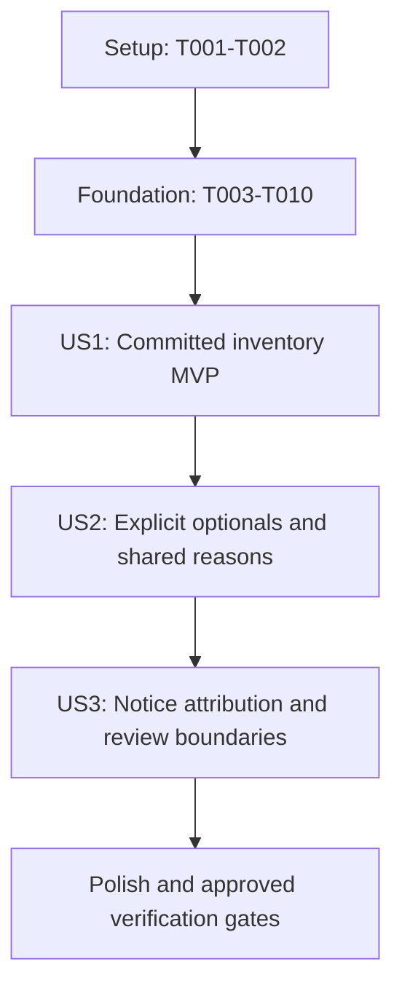

# Tasks: Packaging Inventory Preview

Input: [specification](spec.md), [plan](plan.md), [research](research.md),
[data model](data-model.md), [command contract](contracts/inventory-preview.md) and
[validation guide](quickstart.md). Apply the [constitution](../../.specify/memory/constitution.md)
and its referenced authorities. Resolve the current feature branch locally rather than recording it here.

Tests: The maintainer explicitly requested Pester test-writing tasks during task generation.
That request does not authorize running tests. Before each execution batch, obtain explicit
approval for its scope, including any failing-first run. Write assertions before implementation;
after approval, establish the expected failure before fixing it. Record declined/unavailable checks
as unverified rather than passing. Do not install tools, create a source checkout, commit or push.

Organization: Setup and foundation precede three story increments. US1 is a required-closure
review MVP, not completion of the full optional/provenance contract. Keep safety, mandatory-file
eligibility, cleanup and basic scope disclaimers in the MVP; do not defer them until US3.

## Format

Tasks use `- [ ] Tnnn [P?] [USn?] Description with exact file path`. IDs are execution order;
`[P]` permits the explicitly described separate-file work only after its prerequisites complete.
Story labels appear only in story phases. All tasks start unchecked: generation implements nothing.

## Path Conventions

All task paths are repository-relative. Keep scripts, schemas and tests under the existing
`.github/skills/skill-library/` owner, not a new root project. Reuse adjacent fixture helpers when
suitable; keep new fixture helpers in the one inventory suite unless actual duplication warrants
an existing shared helper. Synthetic repositories belong in Pester temporary space outside the
source worktree. No generated payloads or source revisions are checked out in this repository.

## Phase 1: Setup

Purpose: Prepare the existing focused test infrastructure, without provisioning or executing it.

- [x] T001 Create reusable synthetic committed-library fixtures in `.github/skills/skill-library/scripts/tests/Invoke-InventoryPreview.Tests.ps1`, following adjacent tests; support strict sidecars/defaults, binary blobs, required/optional graphs, notice/external declarations, controlled ignore rules and snapshots of tracked/untracked bytes, index and refs; fixture-only Git mutations must never target the source repository.
- [x] T002 Extend `.github/skills/skill-library/scripts/Invoke-Tests.ps1` to include the new inventory suite alongside validation/preparation, preserve the pinned Pester 5.7.1 import and existing interpreter propagation, fail on failures or zero executed inventory tests, and restore caller environment without installing prerequisites; depends on T001.

Checkpoint: The suite and runner can host incremental cases. No execution approval is implied.

## Phase 2: Foundational Prerequisites

Purpose: Establish the shared trusted-process and inert-snapshot boundaries. This phase blocks
all story implementation. Preserve existing metadata and preparation semantics.

- [x] T003 [P] Add shared-process regression assertions in `.github/skills/skill-library/scripts/tests/Invoke-VersionPreparation.Tests.ps1` for raw binary output, concurrent stderr draining, inherited Git environment isolation and preparation's existing preview/apply behavior; retain release/tag and working-input policies in the preparation owner.
- [x] T004 [P] Add reader-launch regression assertions in `.github/skills/skill-library/scripts/tests/Invoke-Validation.Tests.ps1` using malicious snapshot `yaml.py`/`sitecustomize.py` inputs and inherited Python search paths; trusted installed PyYAML must be used, payload imports must remain inert, strict parsing must retain existing outcomes, and no bytecode may be written.
- [x] T005 [P] Extract only the existing byte-safe subprocess/Git boundary into `.github/skills/skill-library/scripts/Git-Process.ps1` and update `.github/skills/skill-library/scripts/Invoke-VersionPreparation.ps1` to use it; clear inherited `GIT_*` redirects, disable replacements/lazy fetch/optional locks/fsmonitor/transports for inspection, preserve raw stdout and separately drained stderr, and use explicit repository paths plus command-local trust/configuration without global changes; depends on T003 and T004's assertion-writing gate.
- [x] T006 [P] Update `Read-SkillYaml` in `.github/skills/skill-library/scripts/Invoke-Validation.ps1` to launch the trusted adjacent reader with Python `-I -B`, retain the selected installed interpreter/PyYAML checks and strict reader contract, and avoid snapshot working-directory/import influence; depends on T003 and T004's assertion-writing gate, and may proceed alongside T005 because their files differ.
- [x] T007 Implement private committed-source inspection in `.github/skills/skill-library/scripts/Invoke-InventoryPreview.ps1` using the shared Git boundary: resolve one `rev-parse --verify --end-of-options` commit, reject ambiguity warnings/missing local objects, retain full OID without fixed hash length, parse NUL-delimited tree paths and raw blobs, discover immediate opted-in skill trees, and reject unsafe paths/link ancestors/symlinks/gitlinks/case collisions/unsupported modes before inert materialization outside the worktree; accept modes `100644`/`100755`, read no filters, and never recurse into unrelated unconverted trees; depends on T005 and T006.
- [x] T008 Implement trusted-rule capture and catalog validation in `.github/skills/skill-library/scripts/Invoke-InventoryPreview.ps1`: preserve trusted validator/reader/helper/schema relative layout separately from inert historical data, materialize defaults plus every opted-in tree and exact external/notice path for full validation, retain strict raw declarations before normalization, and expose `Invoke-SkillValidation -IncludeCatalog` results without a second resolver or historical code/schema execution; depends on T007.
- [x] T009 Implement snapshot eligibility in `.github/skills/skill-library/scripts/Invoke-InventoryPreview.ps1` with ancestor committed `.gitignore` blobs and `check-ignore --no-index --stdin -z` in empty temporary metadata initialized from an empty template; use inert data as the work-tree argument, no source objects/refs/index, disable system/global/user/info excludes, treat statuses 0/1 as normal, validate full trees before filtering, and distinguish ignored ordinary internal files from failing mandatory selected metadata/entrypoint/external/notices; depends on T008.
- [x] T010 Implement private prerequisite/error/lifecycle handling in `.github/skills/skill-library/scripts/Invoke-InventoryPreview.ps1` for already-installed tools and isolated temporary source/rule/matcher contexts: enforce "Nothing persists between invocations." and "Cleanup errors suppress success", clean up in all success/failure paths, and categorize failures as `Prerequisite`, `Source`, `Validation`, `Eligibility`, `Inspection` or `Cleanup` without raw stderr, contents, credentials or automatic provisioning; depends on T009.

Checkpoint: Source inspection is inert, full-catalog validation remains authoritative, and every
temporary resource has an unconditional cleanup path. No public success inventory exists yet.

## Phase 3: User Story 1 - Review a Committed Inventory (Priority: P1)

Goal: Review one committed root and its transitive required dependencies, eligible internal
resources and mandatory declared files without changing caller source or Git state.

Independent test: Use a synthetic committed root -> required dependency -> required leaf with
a binary resource and mandatory shared notice. Compare exact expected paths, versions and source
OID. Repeat with omitted/repeated roots, dirty index/worktree, missing local files, local-only
metadata, a historical local commit and altered host ignores. Require no unrelated content,
stable output and unchanged tracked/untracked bytes, index and refs on both success and failure.

### Tests for User Story 1

- [x] T011 [P] [US1] Write command/object API assertions in `.github/skills/skill-library/scripts/tests/Invoke-InventoryPreview.Tests.ps1` for the contract's defaults (`RepoRoot` from invoked script, `SourceRevision=HEAD`, empty root/optional arrays, `PythonPath=python3`), inert dot-sourcing, one JSON stdout object and exit 0, sanitized stderr/exit 1 without partial stdout, terminating object errors without host exit, and "Collections remain arrays." for zero/one elements; depends on Phase 2.
- [x] T012 [P] [US1] Refine the required-closure scenario in `specs/001-packaging-inventory-preview/quickstart.md` with an exact membership/source-commit review checklist and before/after state evidence; keep it labelled planned/unrun and exclude optional/provenance-completion claims until their stories pass; may proceed alongside T011.
- [x] T013 [US1] Add committed-input/eligibility assertions in `.github/skills/skill-library/scripts/tests/Invoke-InventoryPreview.Tests.ps1` for transitive requirements, all/default/repeated roots, invalid/unconverted roots, dirty/deleted/local-only inputs, moving refs, historical commits, ambiguous/unavailable revisions/objects, binary bytes/modes, unsafe links/gitlinks/collisions, invalid unselected opted-in records, exact pins/required cycles, nested ignore negation, tracked ignored files, host excludes and ignored mandatory files; reuse T001 fixtures and keep missing/invalid cases free of partial success.
- [x] T014 [US1] Add state/trust/cleanup assertions in `.github/skills/skill-library/scripts/tests/Invoke-InventoryPreview.Tests.ps1` for success and injected read/validation/matcher/cleanup failure, malicious historical scripts/imports, no filters/hooks/fetch/network/advisory execution, deterministic output, temporary removal and byte-for-byte unchanged tracked/untracked content, index and refs; verify cleanup failure suppresses success and diagnostics never echo seeded sensitive fixture content.

### Implementation for User Story 1

- [x] T015 [US1] Build required-selection component records in `.github/skills/skill-library/scripts/Invoke-InventoryPreview.ps1` from validator `SelectedIds`, `Catalog` and `Folders`, without authored identity copies or hyperlink inference; enforce "Validated stable identity and exact declared version." for `Id`/`Version`, derive `NativeFolder`/`Entrypoint`/`SourceCommit`, canonicalize repeated roots, expand omitted roots to all opted-in records, and retain every root/required incoming-edge reason; depends on T011-T014 assertion writing and approved failing-first checks when available.
- [x] T016 [US1] Enumerate selected internal payload and mandatory external/default/component notice files in `.github/skills/skill-library/scripts/Invoke-InventoryPreview.ps1` using validated snapshot entries/eligibility: enforce "Unique exact repository-relative path and chosen commit." and "Binary content is not serialized.", retain source modes `100644`/`100755`, include internal metadata/resources implicitly, exclude unrelated/ordinary ignored content, and fail rather than omit ineligible mandatory files; rule inputs are not automatically payload.
- [x] T017 [US1] Expose `Invoke-SkillInventoryPreview` and script invocation in `.github/skills/skill-library/scripts/Invoke-InventoryPreview.ps1` with the five contract parameters and trusted tool defaults, build complete in-memory `SourceCommit`, `ValidationRules`, `Roots`, `OptionalSelections`, `Components`, `Files`, `Limitations`, use `ValidationRules=invoked-tool-bundle`, preserve arrays, return an object when dot-sourced and serialize exactly one success object only after cleanup when directly invoked; add no apply/export/install/archive/bump/publish options.
- [x] T018 [US1] Apply ordinal deterministic ordering and baseline file attribution in `.github/skills/skill-library/scripts/Invoke-InventoryPreview.ps1`: enforce "output component order is ordinal by ID, not hash-table, caller or directory order.", unique path order, and internal `Kind=internal-content`, owning native-folder `SourcePath`, `Field=implicit-directory`; keep all required-root owners and distinct declaration reasons rather than one arbitrary shared-file reason.
- [x] T019 [US1] Integrate the public failure boundary in `.github/skills/skill-library/scripts/Invoke-InventoryPreview.ps1` with T010 so no debug/native/progress output or partial result escapes, cleanup failure takes precedence over success, and the first usable preview states local edits are excluded and is not a package/release/rights/delivery approval; require source files/index/refs/configuration to remain untouched without payload execution or network.
- [x] T020 [US1] Request approval, then verify US1 cases in `.github/skills/skill-library/scripts/tests/Invoke-InventoryPreview.Tests.ps1` with pinned Pester 5.7.1 and affected validation/preparation regressions through `.github/skills/skill-library/scripts/Invoke-Tests.ps1`; capture nonzero executed counts and actual outcomes in `specs/001-packaging-inventory-preview/quickstart.md`, repair this story before advancing on observed failures, and leave declined/unavailable runs explicitly unverified.

Checkpoint: Required-only MVP is reviewable and safety boundaries hold. A US1 checkpoint is not
a claim that the full optional-selection and detailed notice-provenance contract is complete.

## Phase 4: User Story 2 - Review Explicit Optional Dependencies (Priority: P2)

Goal: Include only explicitly selected reachable optional edges and explain every shared
component/file through all roots and active incoming edges, without another graph authority.

Independent test: Compare one root with and without a reachable optional target that has a
required descendant. Add a nested selected optional, a diamond and two roots sharing a file.
Verify exact added membership, unique components/files and every root/edge/owner reason. Unknown,
duplicate/unreachable choices and selected optional cycles fail without partial stdout; unselected
optional cycles retain existing validator semantics.

### Tests for User Story 2

- [x] T021 [P] [US2] Add optional closure/attribution assertions in `.github/skills/skill-library/scripts/tests/Invoke-InventoryPreview.Tests.ps1` for unselected optionals adding nothing, optional targets' required descendants, nested choices reachable through selected edges, diamonds, multiple roots and shared internal/external files; compare exact owner/root/incoming-edge tuples and ordinal order rather than counts alone; depends on US1.
- [x] T022 [P] [US2] Refine the with/without optional example in `specs/001-packaging-inventory-preview/quickstart.md`, including the existing `patterns-ports-and-adapters/module-composition` identifier, required descendants, shared reasons and the intended no-implicit-expansion outcome; keep runtime outcomes marked pending until observed; may proceed alongside T021.
- [x] T023 [US2] Add invalid-selection assertions in `.github/skills/skill-library/scripts/tests/Invoke-InventoryPreview.Tests.ps1` for unknown/duplicate/unreachable optionals, required exact-pin failures, selected optional cycles and allowed unselected optional cycles; verify validator semantics are preserved, repeated roots normalize but repeated optionals fail, and no partial success is emitted.

### Implementation for User Story 2

- [x] T024 [US2] Complete explicit optional request integration in `.github/skills/skill-library/scripts/Invoke-InventoryPreview.ps1`, forwarding identifiers unchanged to the existing validator and using only returned membership; enforce "Internal requests preserve duplicates until validation rejects repeated optionals." and "Explicit `component-id/selectionKey` identifiers, sorted after validation."; do not pre-deduplicate invalid requests or auto-select downstream optionals.
- [x] T025 [US2] Decorate the selected DAG in `.github/skills/skill-library/scripts/Invoke-InventoryPreview.ps1` with all roots and active incoming required/selected-optional edges, propagate `RootIds` as "Every selected root ID reaching this component, unique and ordinally sorted.", and record `FromId`, `ToId`, `Kind`, `SourcePath`, `Field`, with "`SelectionKey` only for optional edges."; no second resolver or all-path enumeration.
- [x] T026 [US2] Complete cross-root/shared-file deduplication in `.github/skills/skill-library/scripts/Invoke-InventoryPreview.ps1`, enforcing `Owners` as "Every including component ID, unique and ordinally sorted." and `Reasons` as "Distinct attribution tuples, never reduced to one arbitrary category."; retain simultaneous internal/external ownership and all active causes, without relaxing duplicate-declaration/collision checks.
- [x] T027 [US2] Request approval, then verify US2 cases and US1 regressions in `.github/skills/skill-library/scripts/tests/Invoke-InventoryPreview.Tests.ps1`, record nonzero counts and exact added closure/reason evidence in `specs/001-packaging-inventory-preview/quickstart.md`, and fix local failures before advancing; no passing claim for declined/unavailable execution.

Checkpoint: Required-only and explicitly optional selections both work without implicit graph
expansion. Detailed license/notice declaration sources remain the US3 increment.

## Phase 5: User Story 3 - Inspect Notices and Review Boundaries (Priority: P3)

Goal: Report effective license declarations and inherited/additional/external notices with exact
sources and loading purposes; distinguish review inventory from legal or delivery approval.

Independent test: Use two selected components sharing an external instruction and inherited notice,
an explicit equal-valued license override and an added notice. Verify effective declarations,
zero-based field indexes, all owners/categories/loading purposes and no rights inference. Removing
or ignoring any mandatory committed input fails with a sanitized category and unchanged state.

### Tests for User Story 3

- [x] T028 [P] [US3] Add notice/license/external contract assertions in `.github/skills/skill-library/scripts/tests/Invoke-InventoryPreview.Tests.ps1` for default inheritance, different and equal-valued explicit overrides, added/shared notices, external instruction/notice loading purposes, mixed internal/external reasons, missing/ignored mandatory content, invalid duplicate declarations and required scope disclaimers on success plus sanitized failures with unchanged state; depends on US2.
- [x] T029 [P] [US3] Add a declaration-attribution review scenario to `specs/001-packaging-inventory-preview/quickstart.md` covering effective license sources, inherited/additional notices, shared external loading purpose and missing-input failure; identify these as declarations, not rights clearance, and keep evidence pending until observed; may proceed alongside T028.

### Implementation for User Story 3

- [x] T030 [US3] Build effective `License` and `Notices` records in `.github/skills/skill-library/scripts/Invoke-InventoryPreview.ps1` from T008's strict raw mappings plus validated values, preserve explicit equal-valued overrides using field presence, and emit `Value`, `SourcePath`, `Field`, `Origin` with the model's enum "`repository-default` or `component`"; effective notices retain every declaration source rather than guessing after normalized merging.
- [x] T031 [US3] Complete file reason classification in `.github/skills/skill-library/scripts/Invoke-InventoryPreview.ps1` with exactly "`internal-content`, `external-instruction`, `external-notice`, `inherited-notice`, or `component-notice`", preserving each `ComponentId`, `Kind`, `SourcePath`, `Field` and all distinct owners; enforce "Array declarations use zero-based element indexes." and keep internal `Field=implicit-directory`.
- [x] T032 [US3] Retain external `LoadingPurpose` and declared kind in `.github/skills/skill-library/scripts/Invoke-InventoryPreview.ps1`, keep external files mandatory rather than optional graph edges, and enforce "Sort reasons by component, kind, source path and field, with loading purpose as a final tie-breaker." with ordinal comparison; shared-path deduplication must preserve every differing declaration reason.
- [x] T033 [US3] Audit final output/failure boundaries in `.github/skills/skill-library/scripts/Invoke-InventoryPreview.ps1` against `specs/001-packaging-inventory-preview/contracts/inventory-preview.md`: exclude payload bytes/timestamps/digests/durable catalog, preserve local-edits exclusion and absence of immutable provenance, rights clearance, installation/release/publication approval, and emit no full metadata documents or sensitive native diagnostics on either path.
- [x] T034 [US3] Request approval, then verify US3 cases plus US1/US2 regressions in `.github/skills/skill-library/scripts/tests/Invoke-InventoryPreview.Tests.ps1`; record exact shared-notice/override/external-purpose evidence, failure outcomes and nonzero executed counts in `specs/001-packaging-inventory-preview/quickstart.md`; fix observed defects and disclose unrun checks.

Checkpoint: All three story contracts are implemented with no weaker validation, mandatory-file
omission or inferred rights. Complete the cross-cutting gates before claiming feature completion.

## Phase 6: Polish and Cross-Cutting Concerns

Purpose: Align guidance with observed behavior, run approved required gates and record limits.

Disposition: 39 tasks completed, one permanently skipped, none pending. T038's checked marker
records its explicit waiver, not successful execution. On 2026-10-27 the maintainer permanently
waived native Windows verification for this feature: Python tooling stays in the dev container,
and Windows host provisioning is not required. Native Windows behavior remains unverified.

- [x] T035 [P] Update `.github/skills/skill-library/SKILL.md` to document the implemented read-only inventory command, parameters, trusted-rules/source-commit separation, prerequisites, selection/eligibility behavior and approval boundaries; retain authored metadata/schema ownership, native consumption and the explicit statement that archive packaging/installation/publication remain unimplemented; depends on all stories.
- [x] T036 [P] Finalize `specs/001-packaging-inventory-preview/quickstart.md` against the implemented command/runner, retain only accurate examples, consolidate actual per-story evidence and pending gates, and ensure the pinned-commit determinism examples and notices review exercise the final contract; may proceed alongside T035.
- [x] T037 Request approval for the complete Linux focused gate, then run `.github/skills/skill-library/scripts/Invoke-Tests.ps1` with the existing supported interpreter; require nonzero counts for validation, preparation and inventory, zero failures, no provisioning, and record tool versions/counts plus binary/ignore/cleanup/state evidence in `specs/001-packaging-inventory-preview/quickstart.md`; completion requires observed results, not a zero-test exit.
- [x] T038 **PERMANENTLY SKIPPED** by maintainer decision on 2026-10-27: native Windows execution of `.github/skills/skill-library/scripts/Invoke-Tests.ps1` and relevant `specs/001-packaging-inventory-preview/quickstart.md` scenarios is waived for this feature. No Windows host provisioning is required. Native path collisions, modes, binary handling, ignore matching, cleanup and caller-state behavior remain unverified; this disposition is not a test pass or Windows support claim.
- [x] T039 Validate the changed guidance and scripts with editor diagnostics and the applicable repository-configured static/lint gates; follow `.github/instructions/markdown.instructions.md`, `.github/instructions/shell.powershell.instructions.md` and the owning skills, avoid package downloads or broad test execution without approval, and record actual checks and unresolved gaps in `specs/001-packaging-inventory-preview/quickstart.md`.
- [x] T040 Review FR-001 through FR-012 and SC-001 through SC-007 against the implemented `.github/skills/skill-library/scripts/Invoke-InventoryPreview.ps1`, assertions and recorded evidence; update completion checkboxes in `specs/001-packaging-inventory-preview/tasks.md` only for completed work or explicitly recorded maintainer waivers, leave other blocked platform/gate items open, and report no archive/version/tag/install/publication action or legal-clearance claim; no automatic commit/push.

## Dependencies and Execution Order

### Phase Dependencies

1. Setup: T001 -> T002.
2. Foundation: T003/T004 assertion writing -> T005/T006 shared-boundary changes -> T007 ->
   T008 -> T009 -> T010. Approved failing-first execution precedes its implementation when available.
3. US1: T011/T012 -> T013 -> T014 -> T015 -> T016 -> T017 -> T018 -> T019 -> T020.
4. US2: T021/T022 -> T023 -> T024 -> T025 -> T026 -> T027, after US1.
5. US3: T028/T029 -> T030 -> T031 -> T032 -> T033 -> T034, after US2.
6. Polish: T035/T036 -> T037 -> T038 -> T039 -> T040. No later gate converts an unrun earlier
   gate into a passing result. T038 is permanently waived by the recorded maintainer decision,
   not passed; other unavailable gates must remain explicit.

### Dependency Graph



### User Story Dependencies

US1 depends only on foundation. US2 extends US1's working inventory rather than implementing a
competing resolver. US3 extends US2's completed reason tuples. Each story has a distinct fixture
and acceptance test, but these incremental stories share one command/suite and are intentionally
sequential. Do not claim they can be independently implemented in parallel.

### Parallel Opportunities

T003/T004 write assertions in different existing suites. After their gate, T005/T006 change
different implementation files. Each story pairs test authoring with planned validation-guide
preparation; neither pair executes tests or depends on its partner's unfinished edit. T035/T036
update separate guidance files after all stories. Other same-command/same-suite tasks are serial.
Execution approval applies to individual batches, not to all future runs or parallel processes.

## Parallel Example: User Story 1

After foundation, prepare these separate-file changes together; join before T013-T020:

```text
T011: Author US1 API assertions in .github/skills/skill-library/scripts/tests/Invoke-InventoryPreview.Tests.ps1
T012: Prepare required-inventory checks in specs/001-packaging-inventory-preview/quickstart.md
```

## Parallel Example: User Story 2

After the US1 checkpoint, prepare these separate-file changes together; join before T023-T027:

```text
T021: Author optional-closure assertions in .github/skills/skill-library/scripts/tests/Invoke-InventoryPreview.Tests.ps1
T022: Prepare optional review examples in specs/001-packaging-inventory-preview/quickstart.md
```

## Parallel Example: User Story 3

After the US2 checkpoint, prepare these separate-file changes together; join before T030-T034:

```text
T028: Author notice/license assertions in .github/skills/skill-library/scripts/tests/Invoke-InventoryPreview.Tests.ps1
T029: Prepare attribution review checks in specs/001-packaging-inventory-preview/quickstart.md
```

## Requirement Coverage

| Requirement | Primary Tasks |
| --- | --- |
| FR-001 selection/defaults | T008, T011, T013, T015, T024 |
| FR-002 single committed source | T007, T013, T015-T017 |
| FR-003 existing validation authority | T004, T006, T008, T013, T023 |
| FR-004 required/explicit optional closure | T015, T021, T023-T025 |
| FR-005 identity and all component reasons | T015, T018, T025 |
| FR-006 committed eligible internal content | T007-T009, T013, T016 |
| FR-007 external/notices/license sources | T008, T016, T028, T030-T032 |
| FR-008 unique files and all reasons | T018, T021, T025-T026, T031-T032 |
| FR-009 complete sanitized failure | T010-T011, T013-T014, T019, T023, T028 |
| FR-010 deterministic review order | T014, T018, T021, T026, T032 |
| FR-011 read-only offline lifecycle | T003-T010, T014, T017, T019, T037-T038 |
| FR-012 review limitations | T019, T028-T029, T033, T035-T036 |
| SC-001 exact membership | T013, T016, T020, T021, T027, T028, T034 |
| SC-002 full attribution/deduplication | T015, T018, T025-T026, T030-T032 |
| SC-003 exact selected closure | T013, T015, T021, T023-T025 |
| SC-004 no partial-success failures | T011, T013-T014, T019, T023, T028 |
| SC-005 zero source/delivery mutation | T003-T010, T014, T019, T037-T038 |
| SC-006 clear sources and boundaries | T017, T019, T028-T033, T035-T036 |
| SC-007 stable repeated output | T013-T014, T018, T026, T032, T036-T038 |

## Implementation Strategy

### MVP First

Complete setup, foundation and US1 (T001-T020), then stop for its approved independent check.
The MVP reviews committed required closures and mandatory content only; it is not the final
optional/provenance feature. Do not advertise absent US2/US3 behavior or weaken safety for an MVP.

### Incremental Delivery

Complete US2 and its explicit-optional/shared-reason checks, then US3 and its declaration-source
checks. Keep prior story fixtures as regressions. Integrate small changes in the single owning
command; do not introduce a second metadata schema, closure resolver or separate runner.

### Completion Gates

Run only explicitly approved checks. Required Linux/shared-boundary and scoped lint gates passed;
native Windows verification is permanently skipped under T038's recorded waiver. All feature tasks
are closed with that limitation, not with a cross-platform verification claim. A static check is
not runtime or editor-discovery evidence. No packaging, release/version preparation, installation,
rights clearance, publication, automatic commit or push is part of these tasks.
